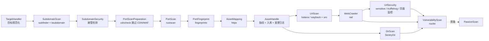

# ScopeSentry-Scan 架构与目录说明

ScopeSentry 的**扫描端**（Node / Agent）。一个进程即一个扫描节点：从 Redis 领取任务与控制指令，按「目标 → 域名 → 端口 → 资产 → URL → 漏洞」的流水线调度插件式扫描器，结果批量写入 MongoDB，同时向 Redis 上报心跳与进度。节点不对外提供 HTTP 接口，服务端与节点之间只通过 MongoDB + Redis 两个中间件耦合。

- 语言 / 版本：Go 1.24（`go.mod`），模块名 `github.com/Autumn-27/ScopeSentry-Scan`
- 版本号：`internal/config/config.go` 中 `global.VERSION = "1.9.1"`
- 官方仓库：https://github.com/Autumn-27/ScopeSentry

---

## 1. 顶层目录

```
ScopeSentry-Scan/
├── cmd/ScopeSentry/        程序入口（package main）
├── internal/               基础设施：配置、存储、任务、插件、结果、协程池
├── modules/                扫描流水线：13 个业务模块 + 各模块内置插件
├── pkg/                    可复用的通用能力（logger、utils 工具箱）
├── libs/                   上游工具源码 fork（go.mod replace 到本地）
├── test/                   手工调试程序集合（package main）
├── tools/                  外置扫描器二进制分发目录（win/linux/darwin）
├── build/                  容器编排与环境变量模板
├── docs/                   架构文档与流程图（__ARCHITECTURE.md、__PLUGIN.md、流程图.svg）
├── .github/workflows.bak/  备份的 CI 配置（main.yml）
├── dockerfile              镜像构建脚本
├── start.sh                容器内启动 / 自更新脚本
├── ScopeSentryConfig.yaml  配置模板（首次运行据此生成 config/config.yaml）
├── .goreleaser.yaml        跨平台构建配置（windows/linux/darwin × amd64）
├── go.mod / go.sum / go.work.sum
├── msyh.ttc                微软雅黑字体，供截图 / 报告渲染
└── README.md
```

| 目录 | 职责 |
|---|---|
| `cmd/ScopeSentry` | 进程入口，串起所有基础设施的初始化，再拉起三条常驻循环 |
| `internal` | 与具体扫描逻辑无关的「底盘」：配置、DB、缓存、任务调度、插件注册、结果入库 |
| `modules` | 业务流水线节点，每个节点 = 一个 `module.go` + 若干插件实现 |
| `pkg` | 无业务耦合的通用库，也被自定义插件通过 `internal/symbols` 暴露使用 |
| `libs` | 为改动方便而 vendor 的上游项目，由 `go.mod` 的 `replace` 指向 |
| `test` | 开发期验证单点行为的一次性程序，编译需指定单个文件 |
| `tools` | 运行期由插件下载 / 解压到 `ext/` 的外置二进制源 |
| `docs` | 架构与机制文档、流程图，纯文档无构建依赖，不参与编译与打包 |

---

## 2. cmd/ScopeSentry —— 程序入口

| 文件 | 简介 |
|---|---|
| `main.go` | 唯一的正式入口。依次初始化 config → MongoDB → Redis → logger → 任务计数器 → 远程配置 → 模块配置 → contextmanager → utils 各组件 → 通知 → 协程池 → bigcache → pebbledb → 结果队列 → 插件管理器；随后起 3 个 goroutine：`task.GetTask()`、`node.Register()`、`configupdater.RefreshConfig()`，`wg.Wait()` 阻塞。Debug 模式额外开 `:6060` pprof。 |
| `restructure_cmd.go` | 早期的另一份 `main()`（数据重构用），与 `main.go` 同包同名函数，仅作历史留存，正常构建不使用。 |
| `test_yaegi.go` | yaegi 解释器的试验性 `main()`，同属调试残留。 |

> 注：三个文件都是 `package main` 且各含 `main()`，因此 `go build ./cmd/ScopeSentry` 会因重复 `main` 报错，构建需指定单文件（`.goreleaser.yaml` 即固定为 `./cmd/ScopeSentry/main.go`）。

---

## 3. internal/ —— 基础设施

### 3.1 `bigcache/`
| 文件 | 简介 |
|---|---|
| `bigcache.go` | 封装 `allegro/bigcache` 为全局 `BigCache`（100MB、1024 分片），提供 `Initialize/Set/Get/Delete`。 |

角色：进程内秒级去重缓存，被 `results/duplicates.go` 与 `task/` 使用；任务结束时整体重建。

### 3.2 `config/`
| 文件 | 简介 |
|---|---|
| `config.go` | `Initialize()`：写死版本号、推导全部运行时路径（`config/`、`tmp/`、`dictionaries/`、`ext/`、`poc/`、`plugin/`）、建目录、加载或首生成 `config/config.yaml`、初始化子域名接管规则与 URL 后缀过滤正则。 |
| `module.go` | 定义 `ModulesConfigStruct`（各模块 goroutineCount），`ModulesInitialize()` 读取 `config/modules.yaml`，`GetGoroutineCount(module)` 供协程池查询。 |
| `utils.go` | `GetDictId(name, category)`：从 MongoDB `dictionary` 集合取字典 ID。 |

### 3.3 `configupdater/`
| 文件 | 简介 |
|---|---|
| `configupdater.go` | `Initialize()`：启动时从服务端一次性拉全量配置——模块参数、字典、subfinder / rad 配置、敏感信息规则、项目忽略规则、POC、指纹、通知渠道、插件源码。 |
| `handler.go` | `RefreshConfig()`：每 3 秒消费 Redis 列表 `refresh_config:<node>`，按 `message.type` 分发（system / dictionary / poc / finger / stop_task / delete_task / install_plugin / restart 等）。 |
| `plugin.go` | 远程插件生命周期：`InstallPlugin`（取源码 → 落盘 → yaegi 加载 → Install/Check → 回写 `NodePlg:<node>`），以及 `DeletePlugin / ReInstall / ReCheck / Uninstall`。 |
| `type.go` | `ConfigResult`、`PluginInfo` 两个 BSON DTO。 |
| `update.go` | 热更新动作：改节点名 / 启停、改时区、动态调整协程池、字典与 POC 增删、`SystemUpdate` 写 `/apps/UPDATE` 后退出等待外部脚本替换。 |
| `webfinger.go` | 指纹规则解析与 AC 自动机构建（`BuildACMatcher` / `NewACMatcher`），产出 `global.WebFingers`。 |
| `webfinger_test.go` | 指纹匹配器单元测试。 |

### 3.4 `contextmanager/`
| 文件 | 简介 |
|---|---|
| `contextmanager.go` | 按 taskID 管理 `context / CancelFunc / WaitGroup`，提供 `Add/Get/Cancel/Delete/WaitForAll`，实现任务级取消与收敛。 |

### 3.5 `global/`
| 文件 | 简介 |
|---|---|
| `global.go` | 全部全局状态：路径常量（`AbsolutePath/ConfigDir/TmpDir/ConfigPath/DictPath/ExtDir/PocDir/PluginDir`）、`VERSION`、`AppConfig`、`SensitiveRules`、`Projects`、`WebFingers`、`NotificationApi/Config`、`NucleiFlag`、自定义插件参数 `sync.Map`、`ScanModule` 模块名清单、内嵌子域名接管指纹。 |
| `type.go` | `Config` / `MongoDBConfig` / `RedisConfig` 的 yaml 结构定义。 |

### 3.6 `handler/`
| 文件 | 简介 |
|---|---|
| `task.go` | 任务运行态：`TaskHandle` 计数器（RunningNum / FinNum）、Redis 进度上报 `StartTask/EndTask/ProgressStart/ProgressEnd/TaskEnd`、`StopTask/DeleteTask/PopTaskId`。 |
| `nuclei.go` | 全局 Nuclei 引擎池：`NewNucleiEngine` 创建并登记引擎、共享模板解析器，`CloseNucleiEngine` 等待并释放全部引擎。 |

### 3.7 `interfaces/`
| 文件 | 简介 |
|---|---|
| `module.go` | 模块接口 `ModuleRunner`：`ModuleRun/SetInput/GetInput/CloseInput/GetName`。 |
| `plugin.go` | 插件接口 `Plugin`：`Execute/Install/Check/UnInstall/Clone` 及参数、任务上下文 setter。 |

### 3.8 `mongodb/`
| 文件 | 简介 |
|---|---|
| `mongodb.go` | Mongo 单例与通用 CRUD：`FindAll/FindOne/Aggregate/InsertOne/InsertMany/BulkWrite/Update/Upsert`，以及 GridFS 读取（字典、指纹文件）。 |
| `settings.go` | 空壳，仅保留包声明（配置已内联到 `Initialize`）。 |

存放：资产、URL、爬虫、目录、敏感信息、漏洞、页面监控等结果集合，以及 `project`、`dictionary`、`PocList`、`FingerprintRules`、`config`、`plugins`、`notification` 等配置集合。

### 3.9 `node/`
| 文件 | 简介 |
|---|---|
| `node.go` | `Register()`：首次以 Redis Hash `node:<nodeName>` 写入节点信息，此后每 20 秒心跳更新 CPU / 内存 / 最大任务数 / running / finished / state / version。 |

### 3.10 `notification/`
| 文件 | 简介 |
|---|---|
| `notification.go` | 按模块划分的通知队列（chan，批量 20 条 / 2 秒），`FlushBuffer` 依据 `global.NotificationApi` 以 GET/POST 外发（Webhook、企业微信等）。 |

### 3.11 `options/`
| 文件 | 简介 |
|---|---|
| `task.go` | `TaskOptions`：任务 ID / 名称 / 目标 / 类型、各模块插件 ID 列表、`Parameters`、`InputChan`（模块输入通道表）、`ModuleRunWg`、`IsRestart`。 |
| `plugin.go` | `PluginOption`：插件运行时上下文（Name / Module / Parameter / ResultFunc / Custom / TaskId / Ctx / Log）。 |

### 3.12 `pebbledb/`
| 文件 | 简介 |
|---|---|
| `pebbledb.go` | Pebble 单例：`Put/Get/Delete/Close/BatchWrite/Compact/GetKeysWithPrefix`。 |
| `settings.go` | `Settings{DBPath, CacheSize, MaxOpenFiles}` 与 `GetPebbleOptions`。 |

用途：本地断点续扫。`task:<taskID>` 存任务快照，`<taskID>:<target>` 作为「未完成目标」占位，重启后据此恢复。

### 3.13 `plugins/`
| 文件 | 简介 |
|---|---|
| `plugins.go` | `PluginManager`：`module → pluginID → Plugin` 二级注册表，`InitializePlugins()` 注册全部内置插件并逐个 Install/Check，状态写入 `NodePlg:<node>`；`GetPlugin` 未命中时从 MongoDB / `plugin/` 目录取源码热加载。 |
| `custom.go` | 基于 yaegi 的 Go 源码插件热加载：`GetCustomPlugin`、`LoadCustomPlugin` 用解释器 + `internal/symbols` 解析出 `Execute/GetName/Install/Check/Uninstall` 并包装为 `customplugin`。 |

### 3.14 `pool/`
| 文件 | 简介 |
|---|---|
| `pool.go` | 基于 `ants` 的协程池管理：按模块名建池（task、各扫描模块），`SubmitTask/CustomSubmitTask/SetGoroutineCount`，`StartMonitoring` 定时打印运行状态。 |

### 3.15 `redis/`
| 文件 | 简介 |
|---|---|
| `redis.go` | go-redis 单例：Hash（`HMSet/HGet/HDel`）、List（`RPush/LIndex/RPop/LPop/LLen/LRange/LRem/BatchGetAndDelete`）、Set（`SAdd/SMembers/SIsMember`）、`Publish/Subscribe`、`Ping`。 |
| `settings.go` | 空壳，仅保留包声明。 |

承载的键：`NodeTask:<node>`、`TaskInfo:<taskID>`、`TaskInfo:progress:*`、`refresh_config:<node>`、`node:<node>`、`NodePlg:<node>`、`duplicates:<task>:*`。

### 3.16 `results/`
| 文件 | 简介 |
|---|---|
| `duplicates.go` | 去重策略：`SubdomainInTask`（bigcache 本地 + Redis Set）、`SubdomainInMongoDb`，以及 URL / 敏感信息的同类去重。 |
| `handler.go` | 各类业务结果的加工与落库方法：子域名、接管、AssetOther / AssetHttp、HTTP 正文 / 图标 / 截图、URL、爬虫、敏感信息、目录、漏洞、页面监控、根域名、APP / 小程序等。 |
| `manage.go` | 按模块划分的结果队列 + 定时 flush（默认 30 秒，URLScan 60 秒），映射到对应 Mongo 集合，`Close()` 收尾。 |
| `result.go` | 底层写库原语：`Insert`、`BulkUpdate`（upsert）、`UpdateNow`、`InsertVulnerabilityScan`（拆分为 vulnerability / vulnerabilityDetail）。 |

### 3.17 `runner/`
| 文件 | 简介 |
|---|---|
| `runner.go` | `Run(op)`：单目标扫描执行体。`StartTask/ProgressStart` → `modules.CreateScanProcess` → 按任务类型注入种子目标 → `ModuleRun()` → `wg.Wait` → `ProgressEnd/TaskEnd/EndTask`，并清理 Linux 临时目录。 |
| `pagemonitoring.go` | 页面监控专线：30 并发抓取，比对状态码与正文 hash、计算相似度，回写 PageMonitoring / PageMonitoringBody。 |

### 3.18 `symbols/`
| 文件 | 简介 |
|---|---|
| `symbols.go` | yaegi 符号表入口 `var Symbols`，含 `go:generate yaegi extract` 声明。 |
| `github_com-Autumn-27-ScopeSentry-Scan-internal-*.go`（12 个） | 自动生成的 reflect 符号表，使自定义插件可 import `bigcache/config/contextmanager/global/interfaces/mongodb/notification/options/pool/redis/results/types`。 |
| `github_com-Autumn-27-ScopeSentry-Scan-pkg-*.go`（2 个） | 同上，暴露 `pkg/logger` 与 `pkg/utils`。 |

仅被 `plugins/custom.go` 使用，是插件解释器的 API 白名单。

### 3.19 `task/`
| 文件 | 简介 |
|---|---|
| `task.go` | 任务主循环：`GetTask` → `RunRedisTask` 每 3 秒查 `NodeTask:<node>`，`GetFirstFromList` 取任务 JSON → `InitTaskOption` → 写 pebbledb → 循环 `PopFromListR("TaskInfo:<id>")` 取目标并 `pool.SubmitTask("task", …)` → 收尾（清缓存、重建 bigcache、`PopTaskId`、`OptionClose`）。`RunPebbledbTask` 负责重启恢复。 |
| `handler.go` | 恢复与参数装配：`RunPebbleTarget`（按 `<taskID>:` 前缀重放未完成目标）、`DeletePebbleTarget`、`InitTaskOption`、`initHttpx`、`OptionClose`。 |

### 3.20 `types/`
| 文件 | 简介 |
|---|---|
| `types.go` | 业务数据模型：SubdomainResult、DomainResolve、DomainSkip、PortAlive、AssetHttp、AssetOther、UrlResult、UrlFile、CrawlerResult、DirResult、SensitiveResult、VulnResult、PageMonit(+Body)、RootDomain、APP、MP、Project、NotificationApi、BulkUpdateOperation 等。 |
| `finger.go` | Web 指纹模型：Fingerprint / FingerprintYaml / Rule / Condition / PatternInfo / WebFingerCore / ACMatcher（title、header、body 三个自动机）。 |

---

## 4. modules/ —— 扫描流水线

统一模式：每个模块一个 `module.go` 实现 `interfaces.ModuleRunner`，只负责「收数据 → 去重 → 投递给插件 → 收结果 → 下发下游」；真正的扫描能力在同目录的插件包里。插件通过 `plugins.GlobalPluginManager.GetPlugin(module, id)` 取实例。

| 文件 / 子目录 | 简介 |
|---|---|
| `manage.go` | `CreateScanProcess(op)`：**唯一装配函数**。以反向链表方式实例化 13 个模块（先建最后一个，再逐层包住下游），为 `op.InputChan` 注册各模块输入通道，通道关闭即向下游级联传播「输入结束」。 |

### 4.1 `targethandler/`——入口，目标解析
| 文件 | 简介 |
|---|---|
| `module.go` | 流水线入口。读取原始目标字符串，按 `op.TargetHandler` 插件列表并发执行，去重后推给 SubdomainScan。 |
| `targetparser/targetparser.go` | 目标解析插件：把域名 / URL / IP / CIDR / 公司名 / ICP 规范化，产出 `string`、`types.RootDomain`、`types.Company`、`types.ICP`。 |

### 4.2 `subdomainscan/`——子域名枚举
| 文件 | 简介 |
|---|---|
| `module.go` | 汇总插件结果，任务内 + Mongo 去重，对非 IP 目标做 DNS 解析，落库并下发 `types.SubdomainResult`。 |
| `subfinder/subfinder.go` | 基于 `projectdiscovery/subfinder/v2` 的被动收集。 |
| `ksubdomain/ksubdomain.go` | 调用外置 `ksubdomain` 二进制做爆破，解析结果文件。 |

### 4.3 `subdomainsecurity/`——子域名接管
| 文件 | 简介 |
|---|---|
| `module.go` | 把 SubdomainResult 转为 `types.DomainResolve` 先下发，再执行安全插件；接管结果直接落库不再下发。 |
| `subdomaintakeover/subdomaintakeover.go` | CNAME 指纹匹配检测子域名接管，产出 `types.SubTakeResult`。 |

### 4.4 `portscanpreparation/`——扫描前过滤
| 文件 | 简介 |
|---|---|
| `module.go` | 结构转换，并允许插件修改 `Skip` 标记，输出 `types.DomainSkip`。 |
| `skipcdn/skipcdn.go` | `projectdiscovery/cdncheck` 判定 CDN / WAF，命中则置 `Skip`。 |

### 4.5 `portscan/`——端口扫描
| 文件 | 简介 |
|---|---|
| `module.go` | 把 DomainSkip 分发给端口扫描插件。 |
| `rustscan/rustscan.go` | 调用 `ext/rustscan/rustscan`（首次运行自动下载并 `chmod 0755`），解析存活端口，产出 `types.PortAlive`。 |

### 4.6 `portfingerprint/`——端口指纹
| 文件 | 简介 |
|---|---|
| `module.go` | PortAlive 逐条投插件，非 PortAlive 数据直通下游。 |
| `fingerprintx/fingerprintx.go` | `praetorian-inc/fingerprintx`（本地 replace 到 `libs/fingerprintx`）做 TCP 协议识别，产出 `types.AssetOther`。 |

### 4.7 `assetmapping/`——HTTP 存活探测
| 文件 | 简介 |
|---|---|
| `module.go` | 与其他模块不同，按「数组」投递插件，收集结果后下发。 |
| `httpx/httpx.go` | `projectdiscovery/httpx`（replace 到 `libs/httpx`）探测状态码 / 标题 / 技术栈 / 截图，产出 `types.AssetHttp`。 |

### 4.8 `assethandle/`——资产入库
| 文件 | 简介 |
|---|---|
| `module.go` | 资产落地核心：Mongo 判重、生成变更日志（`CompareAssetHttp`）、图标 / 正文 / 截图分离存储、合并 `LastScanTime` / `TaskName` / `Tags`。 |
| `webfingerprint/webfingerprint.go` | Web 指纹插件壳（Module = AssetHandle）。 |
| `webfingerprint/core.go` | 指纹引擎，加载规则并为资产填充技术栈。 |
| `webfingerprint/acmatch.go` | Aho-Corasick 多模式匹配 + `projectdiscovery/wappalyzergo`。 |

### 4.9 `urlscan/`——URL 收集
| 文件 | 简介 |
|---|---|
| `module.go` | URL 去重后写入 `tmp/` 暂存并生成 `types.UrlFile`，调用 `uro` 二次去重；无插件时直接把 AssetHttp 转 UrlResult。 |
| `katana/katana.go` | 调用外置 `katana`（`-jsonl`，sonic 解析），产出 UrlResult / CrawlerResult。 |
| `wayback/wayback.go` | 历史 URL 收集插件。 |
| `wayback/source/waybackarchive.go` | Internet Archive CDX 数据源。 |
| `wayback/source/commoncrawl.go` | CommonCrawl 索引数据源。 |
| `wayback/source/alienvault.go` | AlienVault OTX 数据源。 |
| `wayback/source/types.go` | 三源共用的数据结构。 |

### 4.10 `webcrawler/`——爬虫
| 文件 | 简介 |
|---|---|
| `module.go` | 仅处理 `types.UrlFile`，其余输入原样透传；结果去重落库。 |
| `rad/rad.go` | 调用外置 `rad` 爬虫，解析输出为 `types.CrawlerResult`。 |

### 4.11 `urlsecurity/`——URL 侧安全检测
| 文件 | 简介 |
|---|---|
| `module.go` | 分发输入并落库结果（不产生新资产类型）。 |
| `sensitive/sensitive.go` | 正则 / 关键字规则扫描响应体中的敏感信息。 |
| `trufflehog/trufflehog.go` | 集成 `trufflesecurity/trufflehog/v3` 检测密钥泄露。 |
| `pagemonitoring/pagemonitoring.go` | 页面变动监控，产出 PageMonit / PageMonitBody。 |

### 4.12 `dirscan/`——目录扫描（自研 SentryDir）
| 文件 | 简介 |
|---|---|
| `module.go` | 输入原样下发下游，同时调目录扫描插件，DirResult 落库。 |
| `sentrydir/sentrydir.go` | SentryDir 插件入口：读字典 / 参数后交给 controller。 |
| `sentrydir/dirrunner/Controller.go` | 扫描控制器，初始化并驱动 fuzzer。 |
| `sentrydir/dircore/fuzzer.go` | 并发 fuzz 引擎与结果过滤。 |
| `sentrydir/dircore/scanner.go` | 单目标扫描流程。 |
| `sentrydir/dircore/reuqest.go` | 单次请求封装（文件名为历史拼写）。 |
| `sentrydir/dircore/DynamicContentParser.go` | 软 404 与动态内容判定。 |
| `sentrydir/dircore/settings.go` | 并发数 / 超时 / 字典等运行设置。 |
| `sentrydir/dircore/types.go` | 内部结构体定义。 |
| `sentrydir/dirutils/diff.go` | 页面相似度比较（`sergi/go-diff`、simHtml）。 |
| `sentrydir/dirutils/random.go` | 随机路径校准 404 页面。 |

### 4.13 `vulnerabilityscan/`——漏洞扫描
| 文件 | 简介 |
|---|---|
| `module.go` | 每条数据同时旁路推入 `passivescan`，VulnResult 落库。 |
| `nuclei/nuclei.go` | `projectdiscovery/nuclei/v3`（replace 到 `libs/nuclei`）SDK，解析 `catalog/config` 与 `output` 得到漏洞结果。 |

### 4.14 旁路与基座
| 文件 | 简介 |
|---|---|
| `passivescan/module.go` | 被动扫描节点，不在主链上。按任务 ID 动态建通道（`TaskPassiveScanGlobal`、`PassiveScanWgMap`），由 VulnerabilityScan 侧推送数据，`close task` 收尾。 |
| `customplugin/customplugin.go` | 通用插件适配器，实现完整 `interfaces.Plugin`，把 Install / Check / UnInstall / ExecuteFunc 函数指针包装成插件，供 yaegi 自定义插件复用。 |

---

## 5. pkg/ —— 通用能力

### `pkg/logger/`
| 文件 | 简介 |
|---|---|
| `logger.go` | zap 封装：`NewLogger`、`SlogInfo/Warn/Error/Debug` 及 `*Local` 变体；`SendLogToRedis` 推单条日志；`PluginsLog` + 内部缓冲批量推送插件日志；`GetTimeNow`。 |

### `pkg/utils/`（全局单例：`utils.Tools`、`utils.DNS`、`utils.Results` 等）
| 文件 | 简介 |
|---|---|
| `utils.go` | 巨型工具箱：文件读写与锁、JSON / YAML、随机串 / 哈希 / Base62、`ExecuteCommandWithTimeout`、流式读文件、`CdnCheck/WafCheck`、`HttpxResultToAssetHttp`、`GenerateTarget/GenerateIgnore`、解压、PDF 提取、截图压缩、系统占用采集。 |
| `requests.go` | 通用 HTTP 请求封装（`request`、`HttpResponse`、`InitializeRequests`）。 |
| `proxyrequests.go` | 代理请求池：`ProxyRequest`、`CreateClientWithProxy`、`GetProxyClient`。 |
| `clientpool.go` | `ProxyPool`：按代理串缓存 `*http.Client`。 |
| `http.go` | net/http 客户端配置与缓存：`HttpClientConfig`、`GetHttpClient`、`Nethttp`、`GetNetHttpByConfig`。 |
| `httpxrun.go` | httpx 封装：`InitHttpx`（cdncheck / 截图 / TLS / 线程数）、`RunAnalyze(target, cb, param)`、`HttpxClose`。 |
| `dns.go` | `DnsTools`（dnsx / retryabledns）：`QueryOne`、`DNSdataToSubdomainResult` 等解析与结构转换。 |
| `fuzz.go` | 参数盲打：`FuzzGet/FuzzPost/FuzzPostJson`、`GetKeyValue/GetJsonValue`（DNSLog 注入）。 |
| `result.go` | `Result` 与 `InitializeResults`；`CompareAssetHttp` 对比新旧资产生成变更日志。 |
| `semaphore.go` | `GetSemaphore(tp, limit)` 按类型复用带权信号量限流。 |

---

## 6. libs/ —— 本地 fork 的上游项目

`go.mod` 通过 `replace` 指向本地，便于打补丁：

| 目录 | 对应模块 | 用途 |
|---|---|---|
| `libs/fingerprintx` | `github.com/praetorian-inc/fingerprintx` | 端口服务指纹 |
| `libs/gospider` | `github.com/jaeles-project/gospider` | 爬虫库，工程内未直接 import（主链使用外置 `rad` 二进制） |
| `libs/httpx` | `github.com/projectdiscovery/httpx` | HTTP 存活与信息提取 |
| `libs/nuclei` | `github.com/projectdiscovery/nuclei/v3` | 漏洞扫描引擎 |
| `libs/subfinder` | `github.com/projectdiscovery/subfinder/v2` | 被动子域名收集 |

---

## 7. test/、tools/、build/

**test/**：34 个 `package main` 的一次性调试程序，编译需指定文件名。可运行的代表性文件：`testEhole.go`（端到端资产 / 指纹）、`testSens.go`（敏感信息）、`testHttpx.go`、`testKatana.go`、`testFinger.go`（指纹 AC 自动机）、`testBigcache.go` / `testpebb.go`（缓存）、`testUtils.go`、`testRequest.go`、`testJsluice.go`、`testGetPdfContent.go`、`testTime.go`、`testParseFlag.go`、`testConfig.go` / `testUpdateConfig.go`、`testDump.go`、`testdiff.go`、`testReplace.go` / `testRe.go`、`testRandom.go`、`testDownload.go`、`testHttpDoGet.go`。
其余（`testDns.go`、`testSubdomain.go`、`testPortScan.go`、`testNaabu.go`、`testUrlScan.go`、`testVulnScan.go`、`testDirScan.go`、`testCrawler.go`、`testWayback.go`、`testWebFinger.go`、`testDumpPort.go`、`test.go`）为早期模块调试残留，多数导入已注释，指向已迁移的旧包。

**tools/**：外置扫描器二进制分发目录，每平台 4 个文件，插件 `Install()` 时从 GitHub（失败回退 Gitee）下载到 `ext/`。

| 平台 | 文件 |
|---|---|
| `tools/win/` | `katana.exe`、`ksubdomain.exe`、`rad.exe`、`rustscan.exe` |
| `tools/linux/` | `katana`、`ksubdomain`、`rad`、`rustscan` |
| `tools/darwin/` | `katana`、`ksubdomain`、`rad`、`rustscan` |

**build/**：容器编排与环境变量模板。

| 文件 | 简介 |
|---|---|
| `.env` | NodeName、MongoDB / Redis 的账号密码与地址端口。 |
| `scan-docker-compose.yml` | 扫描端服务（镜像 `autumn27/scopesentry-scan`，`network_mode: host`）。 |
| `server-docker-compose.yml` | 服务端（Web / API）编排。 |
| `mongodb-docker-compose.yml` | MongoDB 依赖。 |
| `redis-docker-compose.yml` | Redis 依赖。 |

---

## 8. 运行时目录与本地文件

程序以**可执行文件所在目录**为根（`global.AbsolutePath`），运行时生成：

| 路径 | 用途 |
|---|---|
| `config/config.yaml` | 主配置，首次运行由 `ScopeSentryConfig.yaml` 或环境变量生成 |
| `config/modules.yaml` | 各扫描模块的 goroutine 数量 |
| `config/dir/`、`config/subdomain/` | 目录扫描、子域名扫描的规则/字典落点 |
| `dictionaries/` | 字典文件 |
| `ext/`、`ext/rad/` | 外置扫描器（katana / ksubdomain / rad / rustscan） |
| `poc/` | Nuclei POC |
| `plugin/<module>/` | 自定义插件源码（`.go`），按模块分目录 |
| `tmp/` | URL 暂存等临时文件 |
| `data/`、`data/pebbledb/` | 本地数据与断点续扫数据库（已在 `.gitignore`） |

以上目录由 `config.CreateDir()` 在启动时统一创建。

---

## 9. 启动顺序

```
Banner
 └ config.Initialize()          路径推导、建目录、读 config/config.yaml
 └ mongodb.Initialize()         结果与配置真相源
 └ redis.Initialize()           控制面消息总线
 └ logger.NewLogger()
 └ handler.InitHandle()         任务计数器
 └ configupdater.Initialize()   全量拉取远程配置 / 字典 / POC / 指纹 / 插件源码
 └ config.ModulesInitialize()   模块并发参数
 └ contextmanager.NewContextManager()
 └ utils.Initialize{Tools,DnsTools,Requests,NetHttp,Results,ProxyRequestsPool}()
 └ notification.InitializeNotification()
 └ pool.Initialize() + InitializeModulesPools() + go StartMonitoring()
 └ bigcache.Initialize()        进程内去重
 └ pebbledb.NewPebbleDB()       断点续扫
 └ results.InitializeResultQueue()
 └ plugins.GlobalPluginManager.InitializePlugins()
 └ go pprof()
 └ 三条常驻循环：task.GetTask() / node.Register() / configupdater.RefreshConfig()
```

---

## 10. 任务生命周期

```
task.GetTask
  └ RunRedisTask             每 3s 轮询 NodeTask:<node>
      └ GetFirstFromList     领取任务 JSON
      └ InitTaskOption       组装 options.TaskOptions
      └ pebbledb.Put("task:<id>")
      └ for PopFromListR("TaskInfo:<id>")   逐目标
          └ pool.SubmitTask("task", fn)
              └ runner.Run(op)
                  └ modules.CreateScanProcess  → ModuleRun() → wg.Wait
                  └ handler.TaskHandle.ProgressEnd / TaskEnd
      └ 收尾：清 Redis 缓存、重建 bigcache、PopTaskId、OptionClose、CleanGlobal、CloseNucleiEngine
```

- 暂停 / 删除任务：`handler.TaskHandle.StopTask/DeleteTask` → `contextmanager.CancelContext`，模块链通过 context 退出。
- 进程崩溃恢复：`task.RunPebbledbTask` + `RunPebbleTarget` 按 `<taskID>:<target>` 前缀重放未完成目标。

---

## 11. 扫描流水线

`modules/manage.go: CreateScanProcess()` 反向装配出的实际执行顺序：



数据流主线：`目标 → SubdomainResult → DomainResolve → DomainSkip → PortAlive → AssetOther / AssetHttp → UrlResult / UrlFile → CrawlerResult → DirResult / SensitiveResult / PageMonit → VulnResult`。逆向链表保证每级 `CloseInput()` 关闭通道时向下游级联传达「输入结束」，配合 `ModuleRunWg` 与 contextmanager 收敛整个任务。

---

## 12. 数据落点

| 存储 | 存什么 | 关键 key / 集合 |
|---|---|---|
| Redis | 控制面 | `NodeTask:<node>` 待领任务；`TaskInfo:<taskID>` 待扫目标；`TaskInfo:progress:*` 进度；`refresh_config:<node>` 配置指令；`node:<node>` 心跳；`NodePlg:<node>` 插件状态；`duplicates:<task>:*` 跨节点去重 |
| MongoDB | 结果与配置真相源 | 结果：subdomain、UrlScan、asset、crawler、SensitiveResult、DirScanResult、vulnerability / vulnerabilityDetail、PageMonitoring / PageMonitoringBody；配置：project、dictionary、PocList、FingerprintRules、config、plugins、notification |
| PebbleDB | 断点续扫 | `task:<taskID>` 任务快照；`<taskID>:<target>` 未完成目标占位 |
| bigcache | 进程内秒级去重 | `duplicates:<task>:<type>:<value>`，任务结束后整体重建 |

---

## 13. 插件机制

> 接口定义、yaegi 热加载、注册中心、执行链路与已知问题的完整说明见 [__PLUGIN.md](__PLUGIN.md)，此处仅列要点。

- **抽象**：`internal/interfaces/plugin.go` 定义 `Plugin`（`Execute/Install/Check/UnInstall/Clone` + 参数 setter）；`interfaces.ModuleRunner` 定义模块生命周期。
- **注册**：`internal/plugins/plugins.go: InitializePlugins()` 用 `RegisterPlugin(module, id, plugin)` 建立 `module → id → plugin` 二级表，启动后逐个 Install/Check，结果写 `NodePlg:<node>` 供服务端展示。
- **取用**：模块侧统一 `plugins.GlobalPluginManager.GetPlugin(module, pluginID)`，返回 `Clone()` 副本以避免并发串状态。
- **热加载**：未注册的插件 ID 会走 `LoadPlugFromDB` / `LoadCustomPlugin`，从 MongoDB 或 `plugin/` 目录取 `.go` 源码，用 yaegi 解释执行；`internal/symbols` 决定了插件能 import 哪些内部包。
- **远程装卸**：服务端下发 `install_plugin` / `delete_plugin` 等指令，由 `configupdater/plugin.go` 完成落盘、加载与状态回写，无需重启节点。

---

## 14. 构建与部署

- 本地构建：`goreleaser build --snapshot` 或 `go build -o ScopeSentry-Scan ./cmd/ScopeSentry/main.go`（必须指定单文件，避免同包多 `main`）。
- 交叉编译：`.goreleaser.yaml` 覆盖 windows / linux / darwin × amd64，产物在 `dist/`，`ldflags: -s -w`。
- 镜像构建：`dockerfile` 基于 `python:3.7-slim`（为 `uro` 与截图依赖），安装 chromium / libpcap / JDK，预置 `tools/linux` 下 4 个二进制到 `/apps/ext/`，入口为 `/apps/ScopeSentry-Scan`。
- 自更新：`start.sh` 检测 `/apps/UPDATE`，下载并解压 ZIP 覆盖 `/apps`，失败时回滚 `ScopeSentry.bak`；`configupdater.update.go: SystemUpdate` 负责写入该文件并退出，交由外部脚本重启。
- 节点配置：`build/.env` 提供 `NodeName`、`MONGODB_IP/PORT`、`REDIS_IP/PORT` 及账号密码，容器编排以此注入环境变量。
